# Run graph: before / after the redesign

Compares the Run graph before the redesign (`before/`, recorded from commit `e688b37`)
with the redesigned graph (`after/`), item by item against the inventory in
`run-graph-animations.md`. Both were recorded by `record-run.spec.js` against the
scripted mock API, so both sides run the same three-agent plan with the same timing.

**Status values:**
- **kept**: the same behaviour, restyled to the new tokens.
- **improved**: the same state, shown at least as clearly, with something added.
- **replaced**: shown differently; the reason is given.

Nothing in the inventory was removed.

## Inventory, item by item

### A. Agent nodes

| # | Before | After | Status |
|---|---|---|---|
| A1 | 216×66 card: 5px colour stripe on the left; Title Case name, role, state at the right | 220px card (wider only for long keys) with a 3px top border in the agent colour; index `01`, the full agent key in mono (never cut), the status pill on its own line, a model · tools line | **replaced**: this is the reference AgentNode (DESIGN.md §5.9). The **role** moved from the node to its tooltip, its spoken label and its output card. Flagged to the user for review. |
| A2 | Idle: solid border, "Idle" | Slate "Idle" pill, plain card | kept |
| A3 | Queued: sunken fill, clock + "Queued" | Sunken fill, amber "Queued" pill with the clock | kept |
| A4 | Running: 2px gradient border (agent colour → blue) | 2px sky border, plus the agent's 3px top bar | kept (restyled; still the thicker 2px border, so not colour alone) |
| A5 | Running glow: a layer pulsing opacity 0.25 → 1 every 1.6 s (compositor-only) | The same layer and timing, sky instead of the agent colour | kept. The pack's `.ap-node--running` animates `box-shadow`; it wasn't used, because it repaints every frame. |
| A6 | Spinner in the state slot | Spinner inside the sky "Running" pill | kept |
| A7 | Live elapsed time ticking every 250 ms | Same, next to the pill | kept |
| A8 | Completed: green border, check, duration | Emerald border (400 ms transition), check in the pill, duration; **the check pops once** | improved |
| A9 | Failed: red border and tint, ×, error as a tooltip | Rose border and tint, × in the pill, error as a tooltip; **one short shake (300 ms)** when it fails | improved |
| A10 | Skipped: dashed border, canvas fill, no shadow, muted name, skip icon | Same, with a stronger dashed border (`--field-border`). The first "after" draft was almost invisible; fixed. | kept |
| A11 | "Router" tag beside the name | "Router" tag beside the index | kept |
| A12 | Click / Enter scrolls to the output card and rings it for 1.6 s | Unchanged code | kept |
| A13 | 2px focus outline | 2px outline in the primary violet | kept |
| A14 | Spoken label "Title: running, 3.2 s. Show its output." | Unchanged | kept |

### B. Start / End terminals

| # | Before | After | Status |
|---|---|---|---|
| B1–B5 | Grey pill; green once complete, red on a failed or halted run; End stays grey while running | Same states and colours; uppercase label, card shadow | kept |

### C. Edges

| # | Before | After | Status |
|---|---|---|---|
| C1 | Idle: grey 1.5px | Same | kept |
| C2 | Active: tinted edge, with dashes in the agent colour travelling every 0.9 s | Same | kept |
| C3 | Done: solid 2px in the agent colour | Same (new agent palette) | kept |
| C4 | Failed: red edge and arrow | Rose | kept |
| new | — | **Pending** (a queued agent behind a running one): grey dashes flowing (`.ap-edge-flow`) | added (DESIGN.md §7). It only flows where a hand-off is next, so it never suggests data that isn't moving. |

### D. Canvas

| # | Before | After | Status |
|---|---|---|---|
| D1 | 18px dot grid | 16px dot grid (reference) | kept |
| D2 | dagre layout, left→right, top→bottom under 640px | Same; node width 220 (or the key's width), height 112 | kept |
| D3–D6 | fitView ≤ 100%, zoom controls, follows the theme, measurements kept, loading placeholder | Unchanged | kept |

### E. Around the graph

| # | Before | After | Status |
|---|---|---|---|
| E1 | Live run status badge | Same badge, new tones (running sky, completed emerald, failed rose) | kept |
| E2 | "2/3 done" count | Same | kept |
| E3 | Stop buttons while running | Same | kept |
| E4 | Run button → disabled "Running…" with a spinner | Same; the gradient button's shimmer runs faster while disabled | improved |
| E5 | Starting scrolls the diagram into view | Same; the landing offset was raised for the taller sticky stepper | kept |
| E6–E8 | Timeline bars: growing, breathing, failed, skipped | Same, in the new agent colours | kept |
| E9 | Legend: agent dots and state swatches | Same, with a "Status" label; the swatches keep their non-colour cues (2px running, dashed skipped) | kept |
| E10–E11 | Output cards in agent colours; skeletons while waiting | Same; **each answer fades in when it arrives** | improved |
| E12 | Screen-reader announcements | Unchanged | kept |

### F. Reduced motion

| # | Before | After | Status |
|---|---|---|---|
| F1–F5 | Animations cut to ~0; the glow and dashes freeze but stay visible; spinners become still rings; states still change instantly | Same rules. The new motion (pops, shake, pending-edge flow, live dots, stepper pulse, shimmer) also stops. | kept |

### Update (2026-11-04): running state and straight edges

Three changes to the graph after the redesign; the floor above still holds.

| # | Change | Why |
|---|---|---|
| A4/A6/A7 | **A running agent is always shown while a run is active.** The first queued agent in run order shows as running (timed from the last completion) until the real `node_started` arrives; nothing else is inferred. One status source (`displayRun`) feeds the nodes, the progress rows and the cards. | The server saved events in batches, so `node_started` could reach the console minutes late (see `frontend/e2e/RUN_FIX_LOG.md`). |
| E6 | A node that completed without its `node_started` still gets a progress bar (start = completion − duration). | Same cause. |
| D2 | **START, the agents and END share one centre line;** sequential edges are exactly horizontal. dagre uses each node's measured size, and the view re-fits once after the first measurement. | dagre assumed a 112 px agent height; the real card differs, so the terminals sat off-centre and the edges slanted. |

Checked in `e2e/run-graph.spec.js` (status at every event, with and without reduced motion,
after a failure and after a reload; edges at 1280 / 1440 / 1920 px and after zooming) with
screenshots in `frontend/e2e/__screens__/run/`.

### New motion from DESIGN.md §7, on top of the floor

| Animation | Where |
|---|---|
| Completed check pops | node pill |
| Failed node shakes once | node |
| Pending edges flow (grey) | edges into a queued agent behind a running one |
| Stepper's Run step pulses while a run is going | phase stepper |
| Disabled "Running…" button: faster shimmer | Run button |
| Answers fade in as they arrive | output cards |

## Screenshots, before / after

| State | Before | After |
|---|---|---|
| Idle | 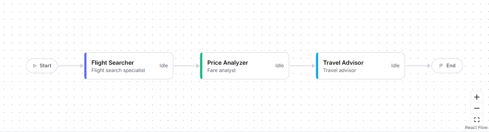 | 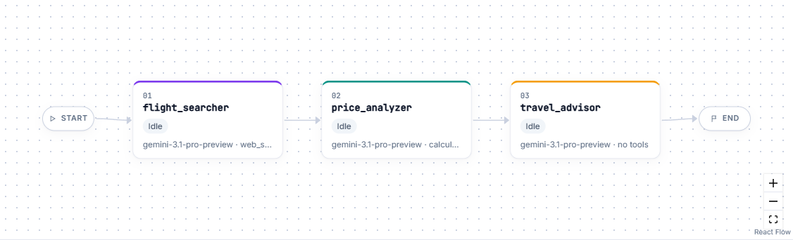 |
| First agent running | 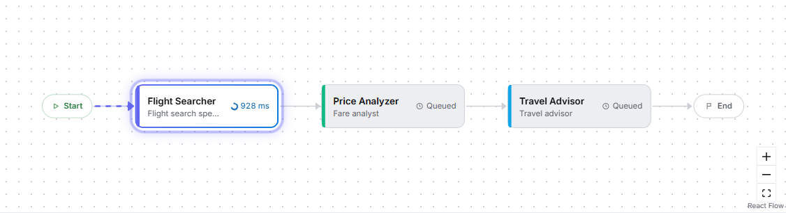 | 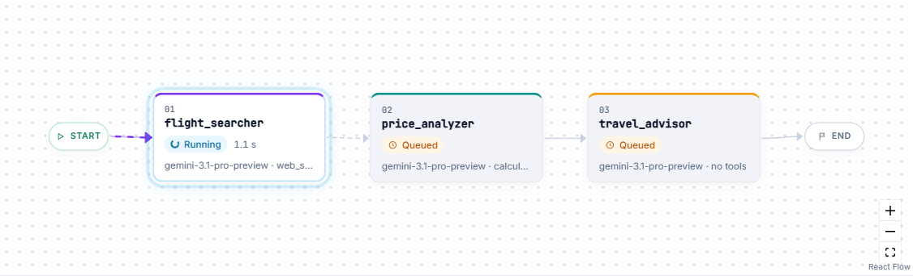 |
| Mid-run | 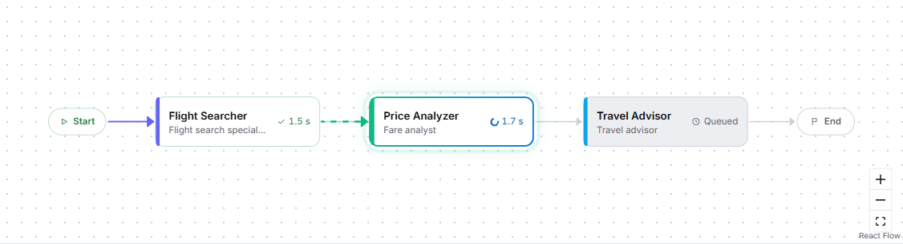 | 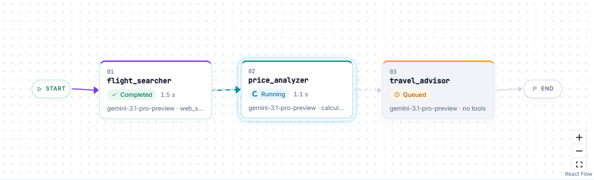 |
| Completed | 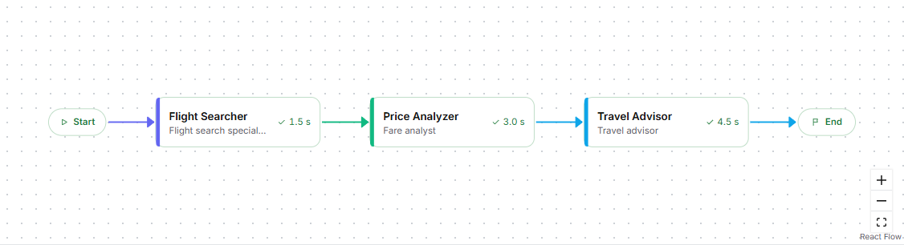 | 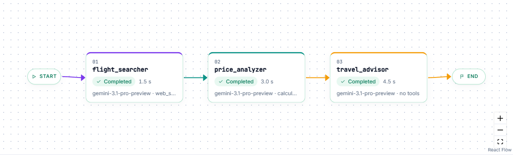 |
| Failed | 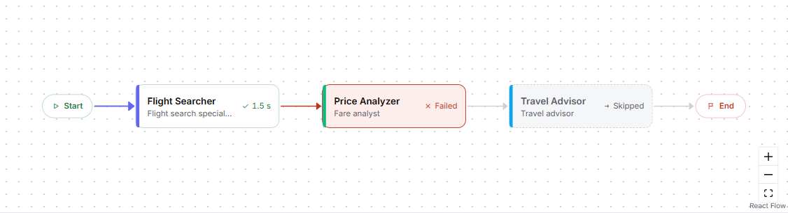 | 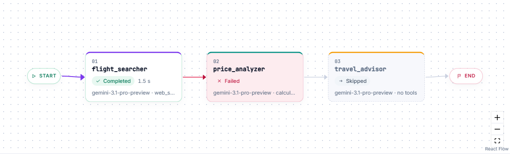 |
| Reduced motion, mid-run | 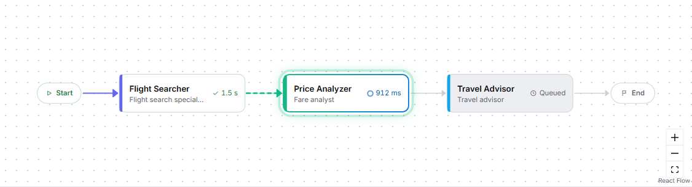 | 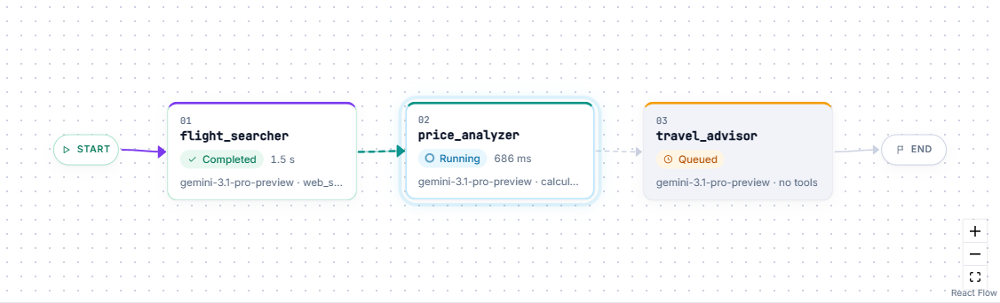 |
| Dark, mid-run | 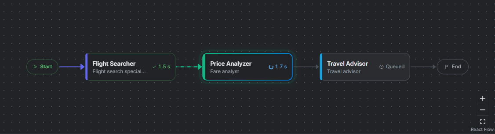 | 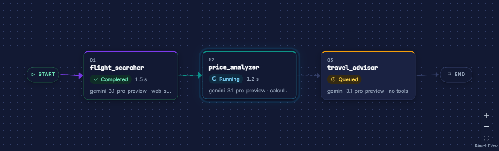 |

Full-page screenshots and videos (`run.webm`, `failed.webm`, `reduced-motion.webm`,
`dark.webm`) are in each folder.

## Checks

### Every status is distinguishable without colour

| State | Cue that isn't colour |
|---|---|
| Idle | "Idle" label |
| Queued | clock icon, "Queued", sunken fill |
| Running | spinner, live time, 2px border, glow |
| Completed | check, "Completed", duration |
| Failed | ×, "Failed", tinted fill, error tooltip |
| Skipped | skip icon, "Skipped", dashed border, no shadow |

### Smoothness

Measured during a full three-agent run.

**Method:**
- **Primary: Chrome's Long Animation Frames API** (`frames.spec.js`), with no tracing
  running, so only the page is measured.
- **Secondary: `record-run.spec.js`'s frame meter**, which runs alongside a Chrome trace.
  That meter swings widely between identical runs (42–89 dropped frames on the same
  code), so it isn't used for the verdict. The traces (`run-trace.json`, kept locally
  and gitignored) were used to find causes.

| Six runs each | Before | After |
|---|---|---|
| Slow frames (≥ 50 ms), total | 10 (0–3 per run) | 16 (1–5 per run) |
| Blocking time, total | 101 ms | 55 ms |
| Slowest frame's main script | React render (`performWorkUntilDeadline`) | React render (`performWorkUntilDeadline`) |

**Verdict:** on par. Slow frames are within run-to-run noise, and blocking time is lower.

**One regression found and fixed:** the first "after" pass did drop more frames. The
pack's `ap-pulse-ring` animates `box-shadow`. The "API online" dot, the "Ready to run"
dot and the running stepper step used it, so the page repainted every frame for as long
as they were on screen. The pulse is now a separate layer that only scales and fades
(compositor-only), in `styles/motion.css`.

### Reduced motion

- **E2e test:** `e2e/run-page.spec.js` › "reduced motion turns the animations off" passes.
  It checks that the glow and the travelling dashes have no animation.
- **Screenshot:** `06-reduced-motion-mid-run` shows every state still visible: the
  running glow is still, the spinner is a still ring, the pending edge is dashed but
  not moving.
- **Instant state changes:** borders, pills and icons switch the moment an event
  arrives.

## How to re-run

```
cd frontend
npm run test:baseline                                     # writes design/baseline/before/
BASELINE_OUT=after npm run test:baseline                  # writes design/baseline/after/
BASELINE_MATCH=frames.spec.js npx playwright test -c playwright.baseline.config.js
```

`before/` was recorded from a checkout of `e688b37` (the code before the redesign),
with the same spec and config.
