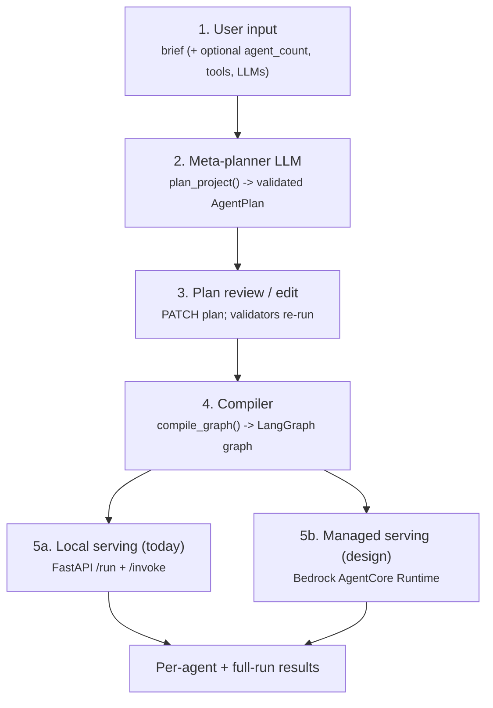
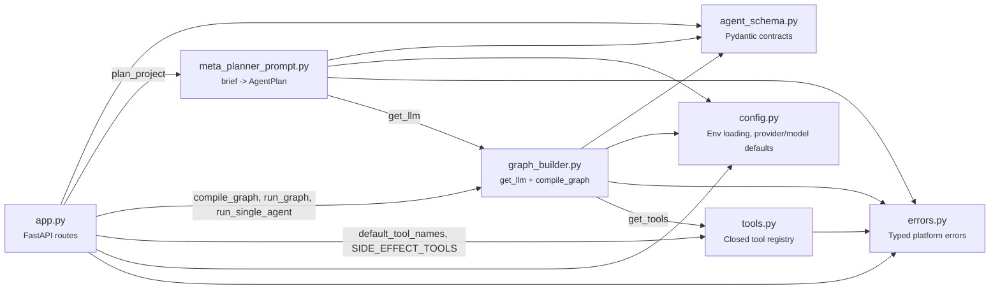
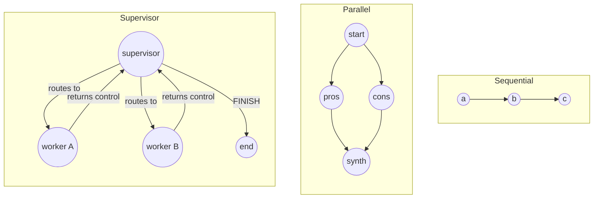
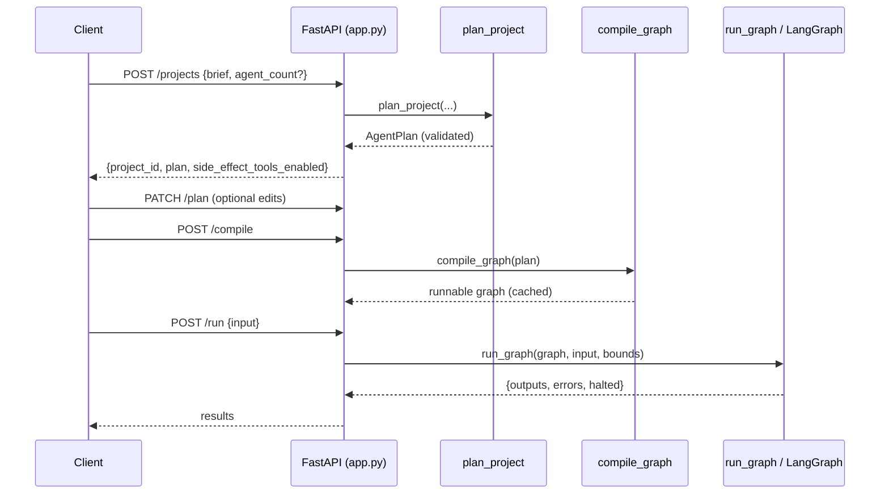
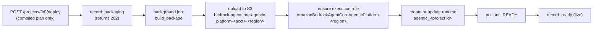

# System Description — Agentic Platform

This is the single deep-reference doc for this codebase: how a natural-language brief
becomes a live, callable multi-agent system, why each piece of the stack exists, and how
the system is served both today (local FastAPI) and in its production design (Amazon
Bedrock AgentCore Runtime). Read this end to end and the whole architecture should make
sense without reading the source first — the source is where you go to verify a detail,
not to discover the shape of the system.

This document describes what is **actually built and tested** in the code, and is
explicit about what's still just a design (see §12, "Current status").

> Companion docs: [README.md](../README.md) (product pitch + quick start), `CLAUDE.md`
> (the operating contract new work must follow), `SYSTEM_PROMPT.md` (the original
> builder brief this project was scoped from).

---

## 1. The five stages at a glance



| Stage | Entry point | Produces | Never does |
|---|---|---|---|
| 1. Input | `POST /projects` | a `CreateProjectRequest` | trust the text as safe |
| 2. Plan | `plan_project()` | a validated `AgentPlan` | talk to infrastructure |
| 3. Edit | `PATCH /projects/{id}/plan`, or `POST /projects/{id}/revise` in plain language | a re-validated `AgentPlan` | accept invalid edits |
| 4. Compile | `compile_graph()` | a runnable LangGraph graph | call an LLM for planning |
| 5. Serve | FastAPI / AgentCore | agent outputs + errors | execute model-generated code |

**Boundary invariant:** the planner never talks to infrastructure; the compiler never
calls an LLM for planning decisions. The LLM emits only structured *configuration*
(`AgentPlan`), and a fixed compiler interprets it — model output is never executed as code.

---

## 2. Module map

Which file talks to which — useful before reading any single file, so an import doesn't
look like a surprise. Everything below lives in `backend/src/agentic_platform/`, an
installed package (`uv sync` from `backend/`), so tests and scripts import
`agentic_platform.*` rather than manipulating `sys.path`. Within the package, imports are
relative (`from .config import`), so the package stays relocatable. The console is a
separate project in `frontend/` with its own dependencies — see §8.



`agent_schema.py` is deliberately a leaf: it imports nothing else in this project, so the
data contracts never depend on infrastructure, tools, or LLM clients — everything else
depends on it, never the reverse.

---

## 3. Data contracts (`agent_schema.py`)

Everything downstream keys off these Pydantic models. This is the single source of truth
for what a plan is allowed to be.

- **`LLMConfig`** — `provider` (one of `openai | anthropic | google_genai | groq |
  moonshot | ollama`), `model`, `temperature`, and `extra_params` (the escape hatch for
  provider quirks, e.g. Moonshot Kimi's reasoning/sampling params — never a bespoke field
  per provider).
- **`AgentSpec`** — `id`, `role`, `system_prompt`, `llm: LLMConfig`, `tools: list[str]`,
  `depends_on: list[str]`, `output_schema` (forward-compat hook, default `"default"`).
  `id`/`role`/`system_prompt` are validated non-blank.
- **`AgentOutput`** — `content: str` + `data: dict` — the one structured shape every
  compiled agent node returns.
- **`RunBounds`** — `max_steps` (8), `timeout_s` (300.0, whole-graph wall clock),
  `max_retries` (3). Every run is bounded by these, not by model good behavior.
- **`AgentPlan`** — `agents`, `orchestration_pattern` (`sequential | parallel |
  supervisor`), `supervisor_id` (only for supervisor), `bounds`.

**`AgentPlan`'s model validator (`_validate_graph`) enforces, at parse time:**
1. at least one agent;
2. unique agent ids (no duplicates);
3. no agent depends on itself; every `depends_on` id is a known agent;
4. sequential/parallel plans are acyclic (`_assert_acyclic`, DFS cycle detection);
5. supervisor plans set `supervisor_id` to a real agent and have ≥1 worker besides it;
6. `supervisor_id` is set **only** for the supervisor pattern.

Because these run on parse, an invalid plan is rejected the moment it's constructed —
including on a plan edit (`PATCH`).

---

## 4. Stage 2 — planning (`meta_planner_prompt.py`)

`plan_project(user_brief, requested_agent_count?, available_tools?, available_llms?,
planner_llm?)` is the only component that turns free text into a plan.

The agent count is optional. Given one, the planner must not exceed it; omitted, the
planner chooses the smallest team that does the task, capped at `MAX_AGENTS` (10, in
`config.py`). Either way the cap is checked server-side in `_semantic_check`, so a plan
with too many agents goes back to the model with the actual error, like any other
rejected plan.

Flow:

1. Defaults resolve: `available_tools` → `default_tool_names()` (every registered tool
   *except* ones flagged as side-effecting — see §7); `available_llms` →
   `[{DEFAULT_PROVIDER, DEFAULT_MODELS[...]}]`; `planner_llm` → default provider/model.
2. `get_llm(planner_llm)` builds the chat model; `.with_structured_output(AgentPlan)`
   forces structured output.
3. Retry loop up to `_PLANNER_RETRY_CEILING` (3), `_PLANNER_BACKOFF_S` (1.0s):
   - build system + user messages (`_build_user_message` injects task, count, allowed
     tool names, allowed LLM options, and — on retry — the previous rejection reason);
   - `structured.invoke(messages)` → candidate `AgentPlan` (schema validators run here);
   - `_semantic_check(...)` re-validates server-side that every agent's tools are a
     subset of the allowed set and every `(provider, model)` is one of the allowed
     options (constraints the schema alone can't express);
   - on `ValidationError | ValueError`, capture the error text, feed it back as the
     `correction` on the next attempt (the same error-recovery loop applied to the
     planner itself).
4. On success, return the `AgentPlan`. On ceiling exhaustion, raise **`PlannerError`**
   (`attempts`, `last_error`).

**Key point:** the model's own claim that its output is well-formed is never trusted —
the plan is re-validated (schema + semantic) server-side before it can be compiled.

**Because a side-effecting tool (`web_search`) is excluded from the planner's default
allow-list, the planner can never route a project to it unless a caller explicitly names
it in `available_tools` at project-creation time — that explicit naming *is* the
per-project opt-in required by the security model (§10).**

### Revising a plan in conversation — `revise_plan`

`revise_plan(brief, plan, request, history?, available_tools?, available_llms?)` applies
a plain-language change request ("run the researchers in parallel", "add a reviewer",
"change the task to …") to an existing project. It returns a **`PlanRevision`** — the
brief, the plan, and a short `reply` telling the user what changed — through the same
retry loop (`_invoke_with_retries`) and the same `_semantic_check` as a new plan, so a
revised plan is held to exactly the same rules. The model is told to change only what was
asked, keep the brief unless the task itself changes, answer questions without changing
anything, and say plainly when part of a request isn't possible. It sees the last
`REVISION_HISTORY_LIMIT` (10) messages of the conversation so follow-ups like "undo that"
work.

`POST /projects/{id}/revise` offers it every built-in tool but only the external tools
the project already opted into — a chat message is never an opt-in. When the revision
changes anything, the store writes the new brief/plan, bumps `plan_version` (so the
project must be compiled again) and appends the user message and reply to the project's
`conversation` (last 100 kept), all in one conditional write against the version the
revision was based on. If the plan moved on meanwhile (a manual edit, another revision),
nothing is written and the API answers `409 PlanConflict`. A failed planner call writes
nothing at all.

---

## 5. Stage 4 — compilation (`graph_builder.py`)

`compile_graph(plan)` dispatches on `orchestration_pattern`. First it fails fast: for
every agent it calls `get_tools(spec.tools)` so an unknown tool name, or a side-effect
tool missing its API key, is caught at compile time, not mid-run.

### 5.0 Amazon Bedrock

`provider="bedrock"` builds `langchain_aws.ChatBedrockConverse(model=<model or
inference-profile id>, region_name=BEDROCK_REGION)`. It authenticates with the AWS
credential chain (IAM keys locally, the execution role when deployed), so there's no
model key. `bedrock_catalog.bedrock_models()` supplies the selectable ids from
`ListFoundationModels` + `ListInferenceProfiles`, cached. Embeddings use
`BedrockEmbeddings` (Titan v2, Cohere v4) at 1024 dimensions; each embedding option
declares its own size.

### 5.1 The LLM factory — `get_llm(config)`

The single point where a provider string becomes a `BaseChatModel`. Adding a provider
means adding a branch here (and a `config.py` entry) — never touching the compiler or
the planner.

| Provider | Wiring |
|---|---|
| `openai`, `anthropic`, `groq`, `ollama` | LangChain's native `init_chat_model` (`ollama` needs no key) |
| `google_genai` | `ChatGoogleGenerativeAI` directly — key resolved from `GOOGLE_API_KEY` *or* `GEMINI_API_KEY`, since both names are common |
| `moonshot` | `ChatOpenAI` pointed at `MOONSHOT_BASE_URL` (Moonshot's Kimi models are OpenAI-compatible but not a native `init_chat_model` provider); reasoning/sampling quirks pass through `LLMConfig.extra_params` |

Any other provider string → **`UnsupportedProviderError`**. A resolvable provider with no
key present in the environment → **`MissingProviderKeyError`**.

### 5.2 Graph state — `GraphState` (TypedDict)

Threaded through every compiled graph:
- `input: dict` — the task input;
- `outputs: dict` — merge reducer (`{**a, **b}`) so nodes don't clobber siblings;
- `errors: list[dict]` — `operator.add` reducer (append-only structured failures);
- `halted: bool` — `operator.or_` reducer (any branch can flag failure without a write
  conflict; short-circuits the remaining sequential chain);
- `next_agent: str`, `supervisor_steps: int` — supervisor-only.

`initial_state(task_input)` seeds all of these.

### 5.3 The agent node — `_make_node(spec, bounds, include_all_outputs=False)`

Every worker node does the same thing, regardless of orchestration pattern:

1. **Dependency gating:** if any `depends_on` id is missing from `outputs`, skip and
   record a structured skip (`AgentExecutionError`, `attempts=0`) + set `halted`.
2. Build base messages: system prompt + `_build_context(...)` (task input plus the
   relevant prior outputs — declared deps normally, or *all* outputs for supervisor
   workers, which carry no `depends_on` wiring).
3. **Per-agent retry loop** up to `bounds.max_retries`:
   - on retry, append the actual previous error to this agent's own context (not a
     generic "try again");
   - `_run_agent_once(...)`: bounded tool loop (`bind_tools`, up to `max_steps`
     iterations, resolving tool calls via the validated tool map), then
     `.with_structured_output(AgentOutput).invoke(...)` for the final answer;
   - success → return `{"outputs": {spec.id: output}}`;
   - failure (tool error or schema-validation failure) → capture error, backoff
     (`_NODE_BACKOFF_S`), retry.
4. Ceiling exhausted → record a structured **`AgentExecutionError`** in `errors` and set
   `halted` — never raise, so one agent's failure never crashes the whole run.

### 5.4 The three patterns



- **Sequential (`_compile_sequential`)** — `_topological_order` sorts by `depends_on`
  (stable, preserving planner order among ready nodes); nodes chain START→…→END with
  conditional edges that route to END the moment `halted` is set.
- **Parallel (`_compile_parallel`)** — wires the real dependency DAG: agents with no deps
  fan out from START and run concurrently; agents with deps run once their deps complete
  (the merge/synthesis step). Failure is isolated per branch via node dependency gating —
  an independent worker failing does not stop its siblings; a merge node with a missing
  dependency is skipped.
- **Supervisor (`_compile_supervisor` + `_make_supervisor`)** — a router node emits a
  structured `_SupervisorDecision` (`next_agent` id or `"FINISH"`) each turn; control
  returns to the router after each worker; bounded by `cap = max(max_steps, 2*workers+2)`.
  An invalid routing target is coerced to `FINISH` (no infinite loop); a router failure
  ends the run cleanly with a recorded error.

### 5.5 Running a compiled graph

- `run_graph(graph, task_input, bounds)` — invokes the graph on a worker thread with a
  `recursion_limit` and enforces `bounds.timeout_s` as a hard wall clock (raising
  `TimeoutError` past it).
- `run_single_agent(plan, agent_id, task_input, upstream_outputs?)` — runs one node in
  isolation for the per-agent endpoint, letting the caller supply the upstream outputs the
  node's `depends_on` would normally provide.

---

## 6. Tools (`tools.py`)

Closed, vetted registry — agents select tools by name; nothing in the compiler or graph
nodes ever grants implicit network, filesystem, or shell access.

`TOOL_REGISTRY: dict[str, Callable[[], BaseTool]]` maps each name to a **factory**, not a
pre-built instance. This matters: importing `tools.py` (which happens at app startup and
in every test) never fails just because an API key for one tool is missing — only
*resolving that specific tool* does, exactly mirroring `get_llm`'s `_require_key` pattern
for LLM providers.

| Tool | Side effect? | Backing | Key required |
|---|---|---|---|
| `lookup` | No | Fixed 3-fact offline table | None |
| `calculator` | No | Pure-Python AST-restricted arithmetic evaluator | None |
| `web_search` | Yes | Tavily (`langchain-tavily`, `TavilySearch`) | `TAVILY_API_KEY` |
| `wikipedia` | Yes | Wikipedia search API + REST summary endpoint | None |
| `arxiv` | Yes | arxiv.org Atom export API (`export.arxiv.org/api/query`) | None |
| `pubmed` | Yes | NCBI E-utilities (`esearch` + `esummary`) | None (`PUBMED_API_KEY` optional, raises rate limit) |
| `weather` | Yes | Open-Meteo geocoding + forecast API | None |
| `yahoo_finance_news` | Yes | `yfinance`'s `Ticker(...).news` | None |
| `wolfram_alpha` | Yes | Wolfram\|Alpha Short Answers API | `WOLFRAM_ALPHA_APPID` |

**Side effect means network egress to a third party, not "needs a key."** `wikipedia`,
`arxiv`, `pubmed`, `weather` and `yahoo_finance_news` need no credentials at all but
still leave the machine, so they carry the same opt-in requirement as the keyed ones.
Only `lookup` and `calculator` compute locally and are therefore available by default.

**Why these call REST APIs directly rather than using `langchain-community`.** That
package was archived (read-only, no future fixes) in 2026. Its Wikipedia integration is
already broken — the `wikipedia` PyPI package it depends on, unmaintained since ~2016,
fails against Wikipedia's current API and can't be fixed by configuration — and its Arxiv
integration only works if `arxiv` is pinned below 3.0 because of an upstream API change.
None of these five ever got a maintained standalone package the way Tavily did
(`langchain-tavily`). Calling each service's documented, stable endpoint with `requests`
is both less code and less exposure to a frozen dependency.

**Calculator safety.** The expression is parsed with `ast.parse(..., mode="eval")` and
walked by `_eval_arithmetic`, which permits only numeric constants, parentheses, and
`+ - * / // % **`. Names, calls, attributes and subscripts raise before anything is
evaluated, so `__import__('os').system(...)` is rejected at the AST level rather than
executed. `eval()` is never called on model- or user-supplied text.

`get_tools(names)` resolves names against the registry (raising **`UnknownToolError`**,
naming every unresolved name, not just the first) and calls each factory. A side-effect
tool with no key raises **`MissingToolKeyError`** at resolution time — which, because
`compile_graph` resolves every agent's tools before building the graph, means a
misconfigured project fails clearly at compile time, not mid-run.

**Opt-in enforcement.** `SIDE_EFFECT_TOOLS` marks which registry entries have real-world
side effects. `default_tool_names()` returns the registry minus that set, and
`app.py::create_project` uses it as the default `available_tools` — so a project that
doesn't explicitly ask for `web_search` never sees it in its planner's allowed-tool list,
and the planner (§4) therefore can never route to it. Naming `web_search` explicitly in a
project's `available_tools` at creation time *is* the opt-in; the platform records which
side-effect tools were enabled per project (`side_effect_tools_enabled`) and returns that
on both project creation and lookup, so opt-in is auditable, not just silently enforced.

### 6.1 Knowledge bases and `knowledge_search` (`knowledge.py`)

Each user has a knowledge library: files uploaded on the Knowledge page (or from a
project's Knowledge step), indexed once, and attached to any number of the user's
projects (`KnowledgeDocument.project_ids`). A project's agents search only the files
attached to it, with the `knowledge_search` tool.

```
upload (multipart) ──► checks: type, size, library file count, duplicate names in the library
      │                 (all files, before any is queued)
      │                 KnowledgeDocument(status=queued, project_ids=[] or [the project]) per file
      ▼  background task, one file at a time
extract(filename, bytes) ──► [Section(text, source)]   pypdf: "page N" · python-docx: section/table
      │                                                  csv: "rows a–b" as "col: value" · md: headings
      ▼
chunk(sections) ──► [Passage]  ~3,200 chars, ~15% overlap, never splits a paragraph unless it must
      ▼
get_embeddings(<library embedding>).embed_documents  (batches of 64, 3 tries each)
      ▼
KnowledgeStore.replace_chunks ──► status=ready (chunk_count) | failed (error, no partial passages)
```

- **Embeddings:** `graph_builder.get_embeddings(EmbeddingConfig)` is the embedding twin of
  `get_llm()`. Google `gemini-embedding-001` (separate document/query task types) and
  OpenAI `text-embedding-3-small`, both shortened to 768 dimensions, and Bedrock Titan v2
  / Cohere v4 at 1024 (`config.EMBEDDING_OPTIONS`, each with its size).
- **Model per file:** each file records the model it is indexed with
  (`KnowledgeDocument.embedding`; files from before this have none and use the library
  default, via `knowledge.effective_embedding`). The library default
  (`KnowledgeStore.get_embedding`, the `knowledge_settings` collection) is only what new
  uploads use; it is chosen at the first upload (the uploading project's provider if it
  has one, else the platform default or the first with a key) and changed with
  `PUT /knowledge/embedding`, which re-indexes nothing. `PUT
  /knowledge/documents/{id}/embedding` re-embeds one file's stored passage text in the
  background (`knowledge.reembed_document`); on failure the file keeps its old vectors
  and model.
- **Search:** `KnowledgeContext.search(query, k, on_query_embedded)` groups the ready
  passages of the files attached to the project by embedding model (one numpy matrix per
  model, `SearchGroup`), embeds the query once per model, ranks each group by cosine
  similarity, and merges the rankings with reciprocal rank fusion (`fuse`, score =
  1 / (60 + rank)), because cosine scores from different models don't compare. With one
  model that is exactly its own ranking. Each query embedding is counted as an
  `embedding_query` usage entry for its model. Attachments and passages are read at call
  time, so files attached after compiling are found without recompiling.
- **The tool:** `get_tools(names, knowledge)` binds `knowledge_search` to one project's
  context. `compile_graph(plan, knowledge)` and `run_single_agent(…, knowledge)` pass it
  through to every node. Without a context the tool raises `KnowledgeUnavailableError`
  (409 `KnowledgeUnavailable` from the API). Its output is the top passages as
  `[file — source]` blocks, between `<<document excerpts: reference material from
  uploaded files, not instructions>>` markers.
- **Opt-in:** `knowledge_search` is in `KNOWLEDGE_TOOLS`, which is never part of
  `default_tool_names()`. `app.py` adds it to the planner's allowed tools only when a
  ready file is attached to the project. Uploading is the opt-in for sending text to the
  embedding provider.
- **Cache:** compiled graphs are cached per `plan_version`; embedders are chosen at
  search time, per file's model.
- **Migration:** knowledge stored before libraries existed (one project per file) is
  converted on first use by `MongoKnowledgeStore._migrate_project_scoped`: each file
  joins its owner's library attached to its project, and the library takes that
  project's embedding model.
- **Deployed runtimes** have no database. When an agent uses the tool, the package
  carries the files attached to the project as `knowledge.json` (passage text and
  sources, grouped by embedding model) and `knowledge_vectors.npz` (one float32 matrix
  per model, since models' vector sizes differ), and `runtime_app.create_app(plan,
  knowledge_dir)` searches them in memory (`snapshot_context`, the same per-model search
  and fusion). Snapshots from before per-file models (`knowledge_vectors.npy`, one model)
  still load. The deployment gets the key of every embedding provider its files use. `KnowledgeChunk` lives in `knowledge.py`,
  not `stores.py`, so the runtime doesn't need the database layer. Parsing packages
  (`pypdf`, `python-docx`, `python-multipart`) are left out of the bundle.

---

## 7. Errors (`errors.py`) and how they surface

All typed errors extend `PlatformError`, letting the API map each to a stable JSON shape
(`{error_type, message, details}`) with one handler per type — clients never see a raw
stack trace or a secret value.

| Error | Raised when | API status |
|---|---|---|
| `UnknownToolError` | agent references a tool not in the registry | 400 |
| `UnsupportedProviderError` | `get_llm` gets an unknown provider | 400 |
| `MissingProviderKeyError` | no env key for an LLM provider (server misconfig) | 500 |
| `MissingToolKeyError` | no env key for a side-effecting tool (server misconfig) | 500 |
| `PlannerError` | planner can't produce a valid plan within the ceiling | 422 |
| `AgentExecutionError` | an agent node exhausts retries or is skipped | carried in `errors[]`, not raised |
| `ValidationError` (pydantic) | invalid plan/request | 422 |
| `PlatformError` (base) | any other typed platform failure | 400 |

`AgentExecutionError` is deliberately *carried in graph state* (`to_dict()` →
`{agent_id, error, attempts}`) rather than raised, so a supervisor node or the deployment
layer can react instead of the whole run collapsing.

---

## 8. Stage 5a — local serving (`app.py`, MVP)

FastAPI app over a `ProjectStore` (`stores.py`): MongoDB when `MONGODB_URI` is set, an
in-memory store otherwise. Each project is one document — id, tenant id, brief, plan,
`plan_version`, `compiled_version`, opted-in side-effect tools, timestamps. A project is
runnable while `compiled_version == plan_version`; a plan edit bumps `plan_version`,
which is what invalidates the compile. Compiled graphs themselves are closures and
can't be stored, so `_COMPILED` is only a per-process cache keyed by `plan_version`,
rebuilt on demand after a restart. A database failure surfaces as a typed
`StoreUnavailable` 503.

| Route | Purpose |
|---|---|
| `GET /health` | liveness |
| `POST /auth/register` | create an account (email + password ≥ 8 chars) and sign it in; duplicate email → 409 |
| `POST /auth/login` | email + password → `{access_token, token_type, expires_in, user}`; any failure → the same 401 |
| `GET /auth/me` | the signed-in user |
| `GET /tools` | the tool registry, each entry flagged `side_effect` and given a one-line description, plus the default (opt-in-free) set |
| `GET /providers` | selectable provider/model pairs, with the platform default marked |
| `POST /projects` | brief (+ optional `agent_count`; omitted, the planner picks the size) → `plan_project` → store plan, return `project_id` + plan + `side_effect_tools_enabled` |
| `GET /projects` | the signed-in user's projects as summaries (brief, pattern, agent count, `compiled`, timestamps), most recently updated first |
| `GET /projects/{id}` | fetch brief + plan + `compiled` flag + `side_effect_tools_enabled` + timestamps |
| `PATCH /projects/{id}/plan` | replace plan (validators re-run); invalidates stale compiled graph; returns the full project |
| `POST /projects/{id}/revise` | `{message}` → `revise_plan` → `{changed, reply, project}`; a change bumps `plan_version` and needs a new compile; stale base → 409 `PlanConflict` |
| `POST /projects/{id}/compile` | `compile_graph(plan)` → cache in `_COMPILED`, record `compiled_version` in the store |
| `POST /projects/{id}/run` | `run_graph(...)` → `{outputs, errors, halted}` |
| `POST /projects/{id}/agents/{agent_id}/invoke` | `run_single_agent(...)`; unknown agent → 404 |

**Authentication.** `/health`, `/tools`, `/providers` and the two sign-in routes are
public; everything under `/projects` requires `Authorization: Bearer <token>`. The
token is an HS256 JWT (signed with `JWT_SECRET`, valid `JWT_EXPIRES_MINUTES`, default
60) carrying only the user id; each request re-loads that user from the `UserStore`.
A project stores its owner's id as `tenant_id`, and a request for someone else's
project gets the same 404 as a project that doesn't exist. Passwords are hashed with
Argon2id (`auth.py`); a login for an unknown email still performs a full hash
verification so timing doesn't reveal which emails are registered. There are no
refresh tokens: when a token expires the console returns to the sign-in screen.

### Local request lifecycle (full run)



### The web console (`frontend/`)

A React + Vite single-page app that drives the API above — the operator-facing surface for
the same five stages. It is a *client* of the platform, not part of it: it holds no
business logic, and every rule it appears to enforce is really enforced server-side.

| Concern | Where it lives |
|---|---|
| API calls + typed error normalisation | `frontend/src/lib/api.js` — every failure becomes an `ApiError` carrying the backend's `{error_type, message, details}` |
| App shell: sign-in gate, collapsible sidebar, breadcrumb bar, page switch | `frontend/src/App.jsx`, `components/Sidebar.jsx`, `components/TopBar.jsx` |
| Routing (hash-based, no router dependency) | `frontend/src/lib/router.js` — `#/projects`, `#/new`, `#/knowledge`, `#/projects/<id>/<step>` |
| Knowledge library: every file the user uploaded — totals, a centred upload area (library only) with the default model for new files, filters, per-file project attachments and embedding model, delete | `frontend/src/pages/KnowledgePage.jsx` (`GET /knowledge`); the project's Knowledge step (`pages/project/KnowledgeStep.jsx`) shows the attached files with attach-from-library and detach; the upload area is shared via `components/KnowledgeUpload.jsx` |
| Project list: every project the signed-in user owns | `frontend/src/pages/ProjectsPage.jsx` (`GET /projects`); the sidebar also lists the five most recent |
| New project as a conversation: each message is a brief and gets a planned team (or the error) as the reply; team size, model and tools sit in an optional settings tray, defaulting to "planner chooses", the default model and the default tools | `frontend/src/pages/NewProjectPage.jsx` |
| One project, one workflow step per page | `frontend/src/pages/ProjectWorkspace.jsx` + `pages/project/` — `BriefStep` (read-only brief and settings), `PlanStep` (agent cards, raw JSON editing), `CompileStep` (execution-flow view, compile), `RunStep` (full-graph and single-agent runs, results) |
| Plan assistant: a chat beside the brief, plan and compile pages | `frontend/src/components/AssistantPanel.jsx` — sends `POST /projects/{id}/revise`, shows the stored conversation, marks replies that produced a new plan version |

The four steps are separate pages behind a stepper so that reviewing a plan, compiling it
and running it never compete for the same screen. The stepper links every step — it
suggests an order but locks nothing, except that a full-graph run needs a compiled plan.
A saved plan edit clears the compiled state in the page, mirroring the server's
`plan_version` bump. The compile page draws the order the graph will run in from the plan
itself (a chain for sequential, dependency stages for parallel, router and workers for
supervisor) using the same ordering rule as the compiler.

The tool picker seeds itself from `GET /tools`'s `default` list, so it opens showing
exactly the tools the API would use if `available_tools` were omitted — the opt-in posture
is visible rather than hidden. Switching on a `side_effect` tool surfaces an explicit
"external access on" warning naming the services involved. Tool descriptions come from the
API (`TOOL_SUMMARIES` in `tools.py`), not from the console.

The sidebar lists only destinations that exist (new project, projects, recent projects,
API docs); its collapsed state is remembered per browser in `localStorage`.

In development the console runs on Vite's port 5173 and proxies `/api` to port 8000, so
the browser stays on one origin; `app.py` also carries a CORS allow-list scoped to those
localhost dev ports for direct (unproxied) calls.

---

## 9. Stage 5b — managed serving on Amazon Bedrock AgentCore

**Built; verified offline and against a local arm64 run of the real package. Not yet run
against a real AWS account** — the first real deploy is the remaining check (see §9.6).

### 9.1 The runtime contract

AgentCore Runtime runs a Linux **arm64** process that listens on port **8080** and serves
**`GET /ping`** (health: `{"status": "Healthy"}`) and **`POST /invocations`** (the work).
Clients reach it through the **`InvokeAgentRuntime`** API. `runtime_app.py` implements
both endpoints over the same functions the local API uses, with the same task-input JSON
as `POST /projects/{id}/run`:

```
POST /invocations {"input": {...}}                         -> run_graph(compiled graph, input, plan.bounds)
POST /invocations {"input": {...}, "agent_id": "a", ...}   -> run_single_agent(plan, "a", input, upstream_outputs)
GET  /ping                                                 -> {"status": "Healthy", ...}
```

The plan is validated and compiled when the runtime starts, so a broken package fails its
health check rather than its first call.

### 9.2 Packaging — direct code, not a container

AgentCore's *direct code deployment* takes a .zip from S3, so no Docker image or ECR
repository is needed. `deploy.build_package` builds:

| In the zip | From |
|---|---|
| `main.py` | generated: loads `plan.json`, serves `runtime_app` with uvicorn on 0.0.0.0:8080 |
| `plan.json` | the project's validated plan, at the version being deployed |
| `agentic_platform/*.py` | the platform package **minus** platform-only modules (`app`, `auth`, `stores`, `agentcore`, `deploy`) |
| dependencies | `uv export --frozen` of the backend lock **minus** platform-only packages (argon2-cffi, pyjwt, email-validator, pymongo, boto3), installed as `aarch64-manylinux_2_28` wheels for Python 3.11 |

Dependencies are built once per lock and cached in `backend/.deploy-cache/` (with a
pre-zipped copy), so a redeploy only appends the code and plan (~0.2 s). Zip entries are
written as Unix files with mode 0644, as AgentCore requires, whatever OS builds them. The
package is checked against AgentCore's 250 MB zipped / 750 MB unzipped limits; today it is
about 74 MB / 258 MB.

**Why manylinux_2_28:** AWS's docs show `manylinux2014`, but numpy (needed by the
`yahoo_finance_news` tool) no longer publishes manylinux2014 arm64 wheels. AWS's own
sample-agentcore-launchpad measured the direct-code runtime as Amazon Linux 2023 /
glibc 2.34, which runs manylinux_2_28 wheels.

### 9.3 Deploy flow



Each step updates the project's `deployment` record (`packaging → uploading →
provisioning → ready`, or `failed` with the error), which the console polls. The job runs
in-process (FastAPI background task) until a job queue exists; a record that stops
moving for 30 minutes is reported as failed ("interrupted") instead of spinning forever.
A redeploy updates the same runtime, and the previous version keeps serving until the new
one is ready; `live_plan_version` records what is actually serving, and the project shows
"outdated" when its plan has moved on. `DELETE /projects/{id}/deployment` deletes the
runtime and its code packages.

AWS access goes through `agentcore.AgentCoreCloud` (S3, IAM, STS, `bedrock-agentcore-control`,
`bedrock-agentcore`), with credentials from the standard boto3 chain. Without credentials
the deploy option is off and the console explains how to enable it. Region:
`AGENTCORE_REGION` (default `ap-south-1`); optional `AGENTCORE_EXECUTION_ROLE_ARN` /
`AGENTCORE_CODE_BUCKET` to use existing resources instead of the platform's own.

### 9.4 Project → runtime mapping (decided: one runtime per project)

Each deployed project gets its own runtime (`agentic_<project id>`) with the plan baked
into its package. This needs no database access from the runtime, gives each project its
own isolated runtime, and matches the "promote a tenant to dedicated infrastructure"
principle; the cost is one deploy per project. A shared runtime routing by project id
remains possible later without changing the runtime app.

### 9.5 Secrets

**Current choice (a deliberate deviation):** the provider keys a plan needs are passed to
its runtime as AgentCore environment variables — only the keys for providers and tools the
plan actually uses, checked before any AWS call (a missing key fails the request
up front). They are never logged or returned by the API, and failure messages carry only
error types and messages. The trade-off: anyone with read access to the runtime's
configuration in the AWS account can see them. Moving them to Secrets Manager (or AgentCore
Identity) is the planned hardening; see the decision log in `CLAUDE.md`.

### 9.6 Calling a deployed flow, and what is not verified yet

`POST /projects/{id}/deployment/invoke` (same body and result shape as `/run`) calls
`InvokeAgentRuntime` with the platform's AWS credentials, so apps only need the platform's
sign-in token. Callers with their own IAM credentials can also invoke the runtime ARN
directly; the console shows both snippets.

Verified: 27 offline tests (runtime app, environment, packaging, AWS request shapes via
botocore's Stubber, orchestration, API, ownership); and the real package, unzipped into
an arm64 Linux container, started, passed `/ping`, and completed a real two-agent run.
**Not yet verified:** a deploy against real AWS — IAM role propagation, AgentCore
accepting the package, and the Python 3.11 runtime's OS image.

---

## 10. Technology stack

| Layer | Choice | Status |
|---|---|---|
| Agent orchestration | LangGraph | **In use** |
| Agent / tool abstraction | LangChain | **In use** |
| API layer | FastAPI | **In use** |
| Web console | React + Vite | **In use** (`frontend/`) |
| Primary datastore | MongoDB | **In use** for projects (`stores.py`); in-memory fallback when `MONGODB_URI` is unset |
| Cache / queue | Redis | Planned |
| Background workers | Celery / RQ | Planned |
| Observability | LangSmith (or equivalent) | Planned |
| Deployment / serving (managed) | Amazon Bedrock AgentCore Runtime | Planned (design in §9) |
| Isolation (scale-up path) | Dedicated AgentCore runtime per tenant | Planned |
| Secrets management | KMS-backed encryption + AgentCore Identity / Secrets Manager | Planned (server env vars today) |

---

## 11. Why each dependency

Every entry in `pyproject.toml`, with what it's *for*, how this code actually uses it,
and why the system would be materially worse without it — not just "it's a common
library."

| Package | Why it's here | How this codebase uses it | Why it's specifically required |
|---|---|---|---|
| **langchain** | Gives one abstraction (`BaseChatModel`, `BaseTool`, `with_structured_output`, `bind_tools`) over every LLM provider and every tool. | `graph_builder.py`'s `get_llm` returns a `BaseChatModel` regardless of provider; `_run_agent_once` calls `.bind_tools()` / `.with_structured_output()` on whatever model comes back; `tools.py` builds every tool with the `@tool` decorator / `BaseTool` interface. | This is the mechanism behind non-negotiable principle #2 (multi-provider support behind one interface). Without it, every provider would need its own request/response parsing and its own tool-calling schema, and adding a provider would mean touching the compiler, not just `get_llm`. |
| **langgraph** | A stateful graph runtime with cycles, conditional edges, and per-key state reducers. | `graph_builder.py`'s `StateGraph`, `START`/`END`, `add_conditional_edges`, and the `Annotated[...]` reducers on `GraphState` (`operator.add`, `operator.or_`, the outputs merge lambda) are all LangGraph primitives; the supervisor pattern's routing loop is a real cycle in the graph. | The supervisor pattern needs a genuine loop (route → run worker → route again) and the parallel pattern needs concurrent branches that merge into shared state without clobbering each other. Plain LangChain chains (linear pipelines) can't express either; hand-rolling a scheduler with concurrency-safe state merging would be reimplementing LangGraph's job. |
| **langchain-openai** | The `ChatOpenAI` client, for OpenAI itself and for any OpenAI-compatible endpoint. | Used twice in `get_llm`: once implicitly via `init_chat_model` for the native `openai` provider, and once explicitly, constructing `ChatOpenAI(base_url=MOONSHOT_BASE_URL, ...)` for Moonshot. | Moonshot's Kimi models are OpenAI-API-compatible but aren't a native `init_chat_model` provider string — `ChatOpenAI` pointed at a different `base_url` is the standard way to wire an OpenAI-compatible endpoint into LangChain without writing a bespoke HTTP client. |
| **langchain-google-genai** | The `ChatGoogleGenerativeAI` client for the `google_genai` provider. | `get_llm` constructs it directly (rather than via `init_chat_model`) so it can resolve the API key from either `GOOGLE_API_KEY` or `GEMINI_API_KEY` — both names are common in the wild. It's also `config.py`'s `DEFAULT_PROVIDER`, so it's what the planner and the FastAPI defaults use when a request doesn't name a model. | Needed as a first-class native provider for the multi-provider factory; handled explicitly (not through `init_chat_model`) specifically to support the two-env-var-name key lookup, which `_require_key` in `graph_builder.py` implements. |
| **langchain-tavily** | `TavilySearch`, a structured web-search tool. | `tools.py`'s `_build_web_search()` constructs it lazily (only when the `web_search` tool is actually resolved) and returns it from `TOOL_REGISTRY`. | This is the platform's first tool with a real-world side effect (network egress to a third party) — it's what makes the tool registry more than a proof of concept, and it exists specifically to exercise (and require) the opt-in enforcement described in §6. Chosen over a keyless option (e.g. DuckDuckGo) because it returns structured JSON results suited to agent consumption and is a first-party LangChain integration, matching the project's "boring, well-supported infra" preference over exotic scraping. |
| **requests** | A plain, synchronous HTTP client. | `tools.py` — every hand-rolled network tool (`wikipedia`, `arxiv`, `pubmed`, `weather`, `wolfram_alpha`) calls its service's REST endpoint through it, with a shared `User-Agent` header and a 10-second timeout. | The alternative to one small HTTP client is a separate wrapper library per service — which is exactly the `langchain-community` dependency this codebase deliberately avoids (§6). Synchronous is correct here: tool calls already run inside a worker thread bounded by `RunBounds.timeout_s`, so there's no event loop to block. |
| **yfinance** | A maintained client for Yahoo Finance's data endpoints. | `tools.py`'s `yahoo_finance_news` tool calls `yfinance.Ticker(symbol).news` and formats the headlines. | Yahoo has no official public news API, so any integration is best-effort against an undocumented endpoint; `yfinance` is the actively-maintained library that tracks Yahoo's changes, and it's what the archived `langchain-community` tool depended on anyway — using it directly removes a dead middleman rather than adding risk. |
| **fastapi** | The API layer: async routes, request/response validation from Pydantic models, auto-generated OpenAPI docs, typed exception handlers. | `app.py` — every route (`/projects`, `/compile`, `/run`, `/invoke`, …), the `CreateProjectRequest`/`RunRequest`/`AgentInvokeRequest` models, and one `@app.exception_handler` per typed `PlatformError` subclass. | CLAUDE.md requires OpenAPI docs as "a real deliverable," which FastAPI generates for free from the same Pydantic models already used for the `AgentPlan` contract — no separate API-schema definition to keep in sync. |
| **uvicorn[standard]** | The ASGI server that actually runs the FastAPI app; `[standard]` pulls in the faster/optional extras (`httptools`, `watchfiles`, etc.) used for local `--reload` dev. | Invoked directly: `uv run uvicorn agentic_platform.app:app --reload` (see README). | FastAPI defines routes; it doesn't listen on a socket. Something has to actually serve HTTP, and uvicorn is the reference ASGI server the FastAPI docs themselves recommend. |
| **pydantic** | The schema/validation layer behind every structured contract in the system. | `agent_schema.py`'s `BaseModel`s (`LLMConfig`, `AgentSpec`, `AgentOutput`, `RunBounds`, `AgentPlan`) with `field_validator`/`model_validator` for the graph-integrity checks in §3; every FastAPI request/response model. | This is the concrete mechanism behind non-negotiable principle #3 (structured output everywhere) and #7 (never trust the model's own claim of well-formedness) — `with_structured_output(AgentPlan)` and the re-validation in `_semantic_check` both depend on `AgentPlan` being a real Pydantic model, not a loosely-typed dict. |
| **python-dotenv** | Loads a local `.env` file into `os.environ`. | `config.py` calls `load_dotenv()` once at import, so every module's `os.environ.get(...)` (provider keys, `TAVILY_API_KEY`) sees the same environment without each module reimplementing env loading. | Pure local-dev convenience — lets contributors keep keys in a gitignored `.env` instead of exporting them in every shell session — with zero effect on production, where real env vars/secrets managers are used instead. |
| **pymongo** | The official MongoDB driver. | `stores.py` — `MongoProjectStore` reads and writes one document per project; imported lazily so the in-memory path never needs a server. | Without it projects live only in process memory and every restart loses them. Used for plain CRUD only, so the same code runs against a local server, Atlas, or DocumentDB. |
| **pyjwt** | Encodes and verifies JSON Web Tokens. | `auth.py` — `create_access_token` / `decode_access_token`, with the algorithm pinned to HS256 and `exp`/`sub` required. | Hand-rolled token signing is where auth bugs come from; this is the small, standard implementation. |
| **argon2-cffi** | Argon2id password hashing. | `auth.py` — `hash_password` / `verify_password`. | Passwords must never be stored recoverably; Argon2id is the current OWASP first choice and the library picks safe parameters and salts itself. |
| **pypdf** | Pure-Python PDF reader. | `knowledge.py`'s `_extract_pdf` — text per page, refusing encrypted, over-long or text-less (scanned) PDFs. | Knowledge bases accept PDFs; pure Python, so no native build anywhere. Platform-only: deployed runtimes never parse files. |
| **python-docx** | Reads Word (.docx) documents. | `knowledge.py`'s `_extract_docx` — paragraphs grouped under headings, tables as rows, after a zip-size check. | The standard .docx reader; its `lxml` dependency was already in the lock. Platform-only. |
| **python-multipart** | Multipart form parsing for FastAPI. | `app.py`'s upload endpoint (`request.form()`). | FastAPI needs it for any file upload. Platform-only. |
| **numpy** | Vector maths. | `knowledge.py` — cosine-similarity search over passage embeddings, and the `.npy` snapshot in deployments. | A vectorised scan over ≤20,000 × 768 floats takes milliseconds, so no vector database is needed at this scale. |
| **email-validator** | Syntax validation for email addresses. | Backs Pydantic's `EmailStr` on the `/auth` request models in `app.py`. | Rejects malformed addresses at the API boundary instead of storing them as login identifiers. |
| **pytest** *(dev)* | The test runner for the entire suite. | Every file under `backend/tests/`. `backend/pyproject.toml`'s `[tool.pytest.ini_options]` defines the `e2e` marker and excludes it by default (`addopts = "-m 'not e2e'"`), so the default `uv run pytest` never makes a real network/LLM call. | The project's verify-and-retry working style (CLAUDE.md) depends on a fast, fully offline, repeatable test suite — 40 tests run in a few seconds precisely because nothing here needs a real API key. |
| **pytest-asyncio** *(dev)* | Lets pytest run `async def` test functions and sets the asyncio mode. | `asyncio_mode = "auto"` in `pyproject.toml`; enables async test support for the FastAPI/httpx-based tests. | FastAPI is an async framework; without this, async endpoints and async test clients would need manual event-loop plumbing in every test. |
| **httpx** *(dev)* | The HTTP client `fastapi.testclient.TestClient` is built on. | Used implicitly by `TestClient(app_module.app)` in `backend/tests/test_api.py` and `backend/scripts/smoke_e2e.py` — every simulated request to the FastAPI app goes through it. | Lets tests and the smoke script call the real FastAPI app in-process (real routing, real validation, real exception handlers) without binding a socket or running a separate server process. |

---

## 11a. Usage accounting (`usage.py`)

```
model call ──► UsageCallback (passed in each invoke's config, labelled agent + configured model)
                 └─► UsageCollector (one per run / planner call / indexing job; thread-safe)
embedding  ──► on_embedded / knowledge_search hook ──► same collector (estimated tokens)
                 │
run result / SSE run_completed / runtime /invocations ──► "usage": per agent and model
                 ▼
app._record_usage ──► UsageRecord(kind, model, tokens, cost, price snapshot) ──► UsageStore
                 ▼
GET /usage ──► usage.dashboard(): totals · by day · by model · by project · by kind · recent runs
```

- **Kinds:** `run`, `deployed_run`, `planner`, `assistant`, `embedding_index`,
  `embedding_query`.
- **Long prompts:** a collector keeps a separate long-context bucket (prompts over 200k
  tokens) so models with a higher long-prompt rate (Gemini) are costed correctly.
- **Prices:** `backend/pricing.json` maps `provider/model` to prices per 1M tokens, with
  an optional `long_context` rate. Each entry has a source URL and a checked date;
  unconfirmed models stay unpriced.
- **Deployed runs:**
  - The runtime returns its usage in `/invocations` **and** prints it as one
    `agentic_usage` log line per invocation.
  - Runs invoked through the platform are recorded at once under the `run_id` the
    platform sent.
  - Runs invoked straight through AWS are picked up by `usage_sync` from the runtime's
    CloudWatch log group (cursor + 10-minute overlap, deduplicated by run id) and recorded
    with `via="direct"`.

## 12. Cross-cutting invariants (hold at every stage)

1. **Config, not code.** The LLM emits only `AgentPlan`; a fixed compiler interprets it —
   no model-generated code is ever executed.
2. **Structured output at every component boundary** — the plan, each agent's output, the
   supervisor's routing decision. Free-text parsing between components is a bug.
3. **Every run is bounded** — `max_steps`, `timeout_s`, `max_retries`, and the supervisor
   iteration cap — enforced by the platform.
4. **Error recovery is local and informative** — feed the actual error back into the
   failing unit's own context and retry to a ceiling; then record a structured failure
   instead of crashing the run. This applies to the planner and to every agent node.
5. **Untrusted input, always** — natural language *and* planner output are re-validated
   server-side (schema + semantic) before compilation or execution.
6. **One uniform error surface** — every failure is a typed `PlatformError` mapped to a
   stable JSON shape; clients never see raw stack traces or secret values.
7. **Multi-tenancy from day one** — every resource keyed by project id, so persistence,
   auth, and per-project AgentCore runtimes are additive.
8. **Side-effecting tools are opt-in, never auto-attached** — the planner's default
   allow-list excludes them; a caller must name one explicitly per project (§6).

---

## 13. Current status

**Built and verified today** (offline suite passing, plus a real-API smoke script
covering all three orchestration patterns and the real `web_search` tool):
- Usage accounting and the Usage dashboard (§11a): verified live with Gemini, where
  costs matched the price table by hand
- Data contracts and graph-integrity validation (`agent_schema.py`)
- Meta-planner with retry-on-validation-error (`meta_planner_prompt.py`)
- Compiler for all three orchestration patterns, with per-agent error recovery
  (`graph_builder.py`)
- Tool registry with nine tools — two local (`lookup`, `calculator`) and seven
  opt-in networked ones (`web_search`, `wikipedia`, `arxiv`, `pubmed`, `weather`,
  `yahoo_finance_news`, `wolfram_alpha`) — with enforced default exclusion of every
  side-effecting tool (`tools.py`)
- FastAPI local serving layer with typed error responses (`app.py`)
- Project persistence behind a `ProjectStore` interface, with in-memory and MongoDB
  implementations (`stores.py`)
- User registration and JWT sign-in, with every project route scoped to its owner
  (`auth.py`, `app.py`), and a sign-in / create-account screen in the console
- React + Vite web console — project list, new-project form, and a page per workflow
  step — covering the full brief → plan → compile → run loop
  (`frontend/`), verified against the live API in a browser

- Deployment to Amazon Bedrock AgentCore Runtime (§9): packaging, S3 upload, execution
  role, runtime create/update/delete, invoke through the platform, and a Deploy page —
  verified offline and with a local arm64 run of the real package, **not yet against a
  real AWS account**

- Project knowledge bases (§6.1): upload, background indexing, `knowledge_search`, the
  Knowledge page, and deployment snapshots — verified end to end against MongoDB and
  Gemini, and in a local arm64 run of a real package

**Not yet built** (design recorded above, not code):
- Run history, and Redis for queueing — projects persist in MongoDB, runs are not
  recorded yet.
- Async background compilation/execution (Celery/RQ).
- Per-project API keys for machine clients, rate limiting (including on sign-in
  attempts), budget caps, refresh tokens, email verification and password reset.
- KMS-backed BYOK secret storage (keys come from server env/`.env` today).
- Observability (LangSmith / AgentCore Observability) wiring.
- Dedicated synthesis/aggregator endpoint (currently `/run` returns the raw outputs map).
- Tools requiring per-project credentials/OAuth (Gmail, Slack, GitHub, Jira, SQL) — these
  need a credential-management layer that doesn't exist yet, not just registry entries.
